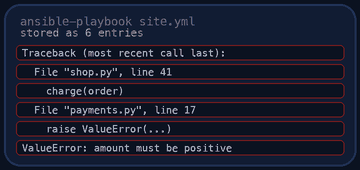

<p align="center"></p>

| | |
|-|-|
| **Time** | 105-120 min |
| **Cost** | free |
| **You need** | Ansible (ansible-core 2.15 or newer), Docker, git, an SSH client, internet access and a terminal (Linux, macOS, or Windows with WSL) |

## How this lab works

1. **Fork** this repository to your own GitHub account (button at the top right).
2. Clone **your fork** in your Ubuntu environment (WSL on Windows, your OrbStack machine on Mac).
3. Read the lab below (the same text is in [`LAB.md`](LAB.md)) and follow the mission.
4. Answer the questions in [`SUBMISSION.md`](SUBMISSION.md). Where a question asks for output, paste it in a code block. No screenshots needed.
5. Commit and push. Open the **Actions** tab of your fork (click *I understand my workflows, go ahead and enable them* the first time). The **Lab check** shows what is still missing.
6. When the check is green, **submit the URL of your fork** in the course platform.

> [!NOTE]
> The check only looks at your answers and any files the lab asks you to commit. Your instructor reads your work and may ask you to explain any line.

<p align="center"></p>

## 🎬 The situation

<p align="center"></p>

Last week you proved that Ansible can configure three servers the same way every time. Now the real application is coming: **Pollie**, the polls app, with a website, an API, a vote worker, PostgreSQL and Redis.

Production will not run everything on one machine. The website goes on one server, the API and the worker on a second one, and the databases on a third, so each can be secured, scaled and replaced on its own. Another team will reuse your work for their own project next month, and a colleague will change settings without ever logging in to a server.

A single 300-line playbook is not reusable and nobody wants to review it. You will split the work into **roles**, render configuration with **Jinja2 templates**, and let **handlers** restart services only when something changed.

> [!IMPORTANT]
> **Your mission**
> - Read a finished role (`common`) before you write one
> - Install the Ansible collection you need from Galaxy and pin it
> - Write three roles: `database` (PostgreSQL + Redis), `pollie` (API + worker as systemd services) and `web` (Nginx in front)
> - Deploy Pollie across the three servers and cast a vote through the website
> - Change a setting with one `-e` flag and watch only the right services restart, without a secret leaking into the output

**Time:** 105-120 min | **Cost:** free | **You need:** Ansible (`ansible-core` 2.15 or newer), Docker, git, an SSH client, internet access and a terminal. On Windows use WSL. `./teardown.sh` removes the lab.

<p align="center"></p>

## Part 0 - Set the scene

Fork this repository, clone your fork, and run:

```bash
./setup.sh
```

It builds three bare Ubuntu 24.04 servers (`pr-web`, `pr-app`, `pr-db`; systemd, SSH, sudo), creates an SSH key in `keys/` and clones Pollie into `pollie/`. This time everything the connection needs is **provided**: `ansible.cfg`, `inventory.ini`, `group_vars/all.yml`. Check you can reach them:

```bash
ansible all -m ping
```

Look at `group_vars/all.yml`. The passwords are in plain text so you can see the stack work first. Remember that. The next lab fixes it.

<p align="center"></p>

## Part 1 - Read a role before you write one

`roles/common/` is the baseline from last lab, packaged as a role:

```bash
find roles/common -type f
```

| Directory | What goes in it |
|-----------|-----------------|
| `tasks/main.yml` | the work, run in order |
| `defaults/main.yml` | variables with a default; the **easiest to override** (lowest precedence), so the right place for "settings" |
| `handlers/main.yml` | tasks that only run when notified |
| `templates/*.j2` | Jinja2 files rendered with the variables, in `templates/` so `template: src: name.j2` finds them |
| `meta/main.yml` | name, description, dependencies on other roles |

Notice how the motd became a variable (`common_motd`) rendered by a template, instead of text inside a task. Then run it:

```bash
ansible-playbook site.yml
```

> [!NOTE]
> **Think** A play lists `roles: [common]`, and Ansible looks for `roles/common/tasks/main.yml`. What did the role give you that a flat playbook does not? (Think of the next team that wants the same baseline.)

<p align="center"></p>

## Part 2 - Galaxy: do not write what already exists

Ansible's own modules ship in `ansible-core`, but many live in **collections**. Managing PostgreSQL databases and users from Ansible is `community.postgresql`.

1. Install it: `ansible-galaxy collection install community.postgresql`.
2. Write `requirements.yml` so a teammate (and CI) can install **the same version** with one command: `ansible-galaxy collection install -r requirements.yml`. Pin it to a compatible range, not "latest".
3. Read the module docs: `ansible-doc community.postgresql.postgresql_db`.

<p align="center"></p>

## Part 3 - The `database` role

Goal: on `pr-db`, PostgreSQL and Redis, reachable from the app server and from nowhere else.

| Requirement | Hint |
|-------------|------|
| PostgreSQL, Redis, and `python3-psycopg2` (the collection needs it on the **server**) installed | `apt` |
| PostgreSQL accepts connections from the network, not only localhost | a `listen_addresses` setting in a **drop-in file** under `/etc/postgresql/16/main/conf.d/` (a template), not an edit of the main file |
| A PostgreSQL user and database from the variables in `group_vars/all.yml` | `postgresql_user`, `postgresql_db`; both run `become_user: postgres`; **create the user first**, then the database **with that user as owner** (PostgreSQL 15+ only lets the owner create tables) |
| Only the local network may log in, with `scram-sha-256` | `postgresql_pg_hba` with `source: samenet`. Never `0.0.0.0/0` |
| Redis listens on the network and **requires the password** | a template for `/etc/redis/redis.conf` with `bind`, `requirepass {{ redis_password }}`; mode `0640`, owner `redis` |
| Both services started and enabled | `service` |
| Reloads and restarts only when config changed | handlers: reload PostgreSQL when `pg_hba` changes, restart when `listen_addresses` changes; restart Redis |

Default settings (for example the PostgreSQL version, `16`) go in `defaults/main.yml`. Passwords already come from `group_vars`. Put `no_log: true` on every task that has a password in its parameters.

Apply just this tier:

```bash
ansible-playbook site.yml --tags db
```

> [!TIP]
> **Checkpoint** From your machine: `docker exec pr-db redis-cli ping` answers `NOAUTH Authentication required`, and `docker exec pr-db su postgres -c "psql -l"` lists the `pollie` database owned by `pollie`.

> [!NOTE]
> **Think** Which of the two (`pg_hba` or Redis `requirepass`) decides **who may connect from where**, and which decides **who you are once connected**? Why do you want both?

<p align="center"></p>

## Part 4 - The `pollie` role

Goal: on `pr-app`, the API (`uvicorn`) and the worker as `systemd` services that run as the `pollie` user, read their configuration from one environment file, and restart themselves when it changes.

Pollie reads everything from environment variables. Its `.env.example` shows them. The commands are:

| Process | Command (from `/opt/pollie/app`) |
|---------|----------------------------------|
| API | `/opt/pollie/venv/bin/uvicorn pollie.api.main:app --host 0.0.0.0 --port 8000` |
| Worker | `/opt/pollie/venv/bin/python -m pollie.worker` |

Do this, in order:

1. Install `python3-venv` and `python3-pip`.
2. Create `/opt/pollie`, `/opt/pollie/app` and `/etc/pollie` (group `pollie`).
3. Copy Pollie's code (`pollie/pollie/` in the repo you cloned: use `{{ playbook_dir }}/pollie/pollie/`) and `pollie/requirements.txt` to `/opt/pollie/app/`.
4. Install the requirements in a **virtualenv** at `/opt/pollie/venv` with the `pip` module.
5. Template `/etc/pollie/pollie.env` from `templates/pollie.env.j2` (**mode `0640`, owner `root`, group `pollie`**: it holds passwords). It must contain at least `DATABASE_URL`, `REDIS_URL`, `APP_VERSION`, `LOG_LEVEL`, `LOG_FORMAT` and `RESULTS_CACHE_TTL`, built from variables. The database and Redis host is the **inventory name** of the database server: `{{ groups['db'][0] }}`.
6. Template the systemd units. There are two services that differ only by name and command, so use **one** template `pollie.service.j2` and a **loop** over a list variable `pollie_services` (name, description, command) defined in `defaults/main.yml`. The units run as user `pollie`, use `EnvironmentFile=/etc/pollie/pollie.env` and `Restart=on-failure`.
7. Start and enable `pollie-api` and `pollie-worker`.
8. A handler restarts both services whenever the code, the dependencies, the env file or a unit changed. Put `flush_handlers` before the "started and enabled" task if a fresh unit is not found yet.

Name these variables exactly (the check relies on them), all with defaults in `defaults/main.yml`: `pollie_log_level` (`info`), `pollie_log_format` (`json`), `pollie_results_cache_ttl` (`5`), `pollie_app_version` (`0.1.1`).

> **Watch out** Both passwords contain `@`, `/` and `:` characters. In a URL, those mean something. The Jinja2 filter `urlencode` escapes most of them but **leaves `/` alone**; chain `| replace('/', '%2F')` after it. Without this, the API cannot connect and the logs say so (`journalctl -u pollie-api -n 20` on the server: `docker exec pr-app journalctl -u pollie-api -n 20 --no-pager`).

Apply the tier:

```bash
ansible-playbook site.yml --tags pollie
```

> [!TIP]
> **Checkpoint** `docker exec pr-app systemctl is-active pollie-api pollie-worker` prints `active` twice, and `docker exec pr-app curl -s localhost:8000/readyz` says the database and redis are `true`.

<p align="center"></p>

## Part 5 - The `web` role

Goal: on `pr-web`, Nginx serves Pollie's static site and forwards `/api/` to the API server.

This is last lab's web play, now a role, with one difference: the config template contains a `location /api/` that sends requests to `http://<app server>:8000/` (with the trailing `/`, so Nginx strips the `/api` prefix).

```text
location /api/ {
    proxy_pass http://UPSTREAM:PORT/;
    ...
}
```

Fill the upstream with variables: `web_upstream_host` (default: the inventory name of the first host of group `app`, `{{ groups['app'][0] }}`) and `web_upstream_port` (the `pollie_api_port` from `group_vars`), both in `defaults/main.yml`. Keep the web root as `web_root` (`/var/www/pollie`). Remove Ubuntu's default site, keep the `X-Served-By` header and the reload handler.

```bash
ansible-playbook site.yml --tags web
```

Now put the three tiers together. In `site.yml`, each play uses one role, has `become: true` and a **tag** named after its tier (`common`, `db`, `pollie`, `web`).

```bash
ansible-playbook site.yml
```

Run it **twice**; the second must say `changed=0` everywhere.

<p align="center"></p>

## Part 6 - Use it

Open <http://localhost:8080>: create a poll and vote. Then do the same on the command line, the way a monitoring script would:

```bash
curl -s -X POST -H 'content-type: application/json' \
  -d '{"question":"Tabs or spaces?","options":["tabs","spaces"]}' localhost:8080/api/polls
```

Use the `id` and an option `id` from the answer for a vote (`POST /api/polls/<id>/votes` with `{"option_id": N, "voter_id": "me"}`), wait a second, then `GET /api/polls/<id>/results`.

> [!NOTE]
> **Think** Your vote went through four processes on three machines. Name them in order, and say where it was stored first and where it ended up.

<p align="center"></p>

## Part 7 - Change a setting without logging in anywhere

A colleague asks for debug logs. Do not edit any server. Change the variable:

```bash
ansible-playbook site.yml -e pollie_log_level=debug --diff
```

Read the output: which tasks changed, which handlers ran, on which hosts? Did Nginx restart? Did a password appear in the diff? (If one did, a task needs `no_log: true`.) Then run the playbook again **without** `-e` and confirm that the setting goes back.

### Break it on purpose

1. Stop the worker by hand: `docker exec pr-app systemctl stop pollie-worker`. Run `ansible-playbook site.yml --tags pollie --check --diff`. What does it say it would do? Apply it for real.
2. Break the password in `group_vars/all.yml` for the database user only (for example change one character), run `--tags pollie`, and watch `readyz` and the logs. Which side fails first, and which tool shows you? Put it back and re-run the playbook.

> [!NOTE]
> **Think** `--tags` and `--check` let you ask "what would this change?" about only one tier. Why does that matter for a production system you are afraid to touch?

<p align="center"></p>

## Part 8 - Prove it

<p align="center"></p>

```bash
./verify.sh
```

It checks the structure of your roles, applies them twice, casts a vote through the website, inspects permissions and network exposure, changes a setting with `-e`, simulates drift and repairs it. It takes a few minutes. Fix what is red until it ends with **ALL CHECKS PASSED**.

> [!TIP]
> **Stuck?** `ansible-playbook site.yml -v` shows module results; `-vvv` shows the connection. `ansible-doc <module>` has examples. If PostgreSQL says `permission denied for schema public`, the database user does not own the database. If a service flaps, read `journalctl -u pollie-api` on the server (`docker exec pr-app ...`).

<p align="center"></p>

## Level up (optional)

- Add `meta/main.yml` with `dependencies: [common]` to the `pollie` role and drop `common` from the playbook for `app`.
- Use a second inventory group `staging` with its own `group_vars/staging.yml`, and the same roles.
- Add a `serial: 1` and a health check task (`uri` against `/readyz`) so that a bad release stops after the first host.
- Next lab: the same stack, with the passwords moved into Ansible Vault.

<!-- teardown:start (generated by labs.py, do not edit) -->
## Tear down (mandatory)

<p align="center"></p>

Resources left behind cost money, keep doors open and pollute the next lab. Removing what you created is part of the job, so it is part of the submission: **you must prove it is gone**.

Do this **last**, after you have pasted your `verify` output into `SUBMISSION.md` (once you tear down, the lab can no longer be verified).

1. Run `./teardown.sh`. It removes the three servers (labelled `lab=ansible-roles-pollie`), their network, the SSH keys and the cloned Pollie source. Your roles and answers stay.

Then run the proof:

```bash
./verify-teardown.sh
```

It prints a list of checks and must end with **TEARDOWN VERIFIED**. If it reports leftovers, remove them and run it again. Paste the full output in your submission.
<!-- teardown:end -->

<!-- submission:start (generated by labs.py, do not edit) -->
## 📬 Submission

Answer the questions in `SUBMISSION.md` in **your fork** (paste output in code blocks where asked), push, then submit the **URL of your fork**.

**Files to commit**

- `requirements.yml`: the Galaxy collections your roles need
- `site.yml`: the playbook that applies your roles
- `roles/database/`, `roles/pollie/`, `roles/web/`: the three roles you write

**Questions to answer**

1. Read the provided `roles/common/` first. Paste its directory tree (`tree roles/common` or `find`). What goes in `tasks/`, `defaults/`, `handlers/`, `templates/` and `meta/`, and why is `defaults/` the weakest place in the variable precedence order?
2. Paste the content of `roles/pollie/templates/pollie.env.j2` and the rendered file from the server (with the passwords hidden). Why does the database password need `| urlencode` in the URL but not in the PostgreSQL role task?
3. You used one template for both systemd units and a loop over `pollie_services`. Paste the loop in your tasks and one rendered unit. What would adding a third process (for example a scheduler) cost with this design, compared to copy-pasting a second unit file?
4. Paste `ansible-galaxy collection install` and your `requirements.yml`. Why pin versions of collections, and where would a team keep them?
5. Run `ansible-playbook site.yml -e pollie_log_level=debug`. Paste the recap and the handler lines. Which services restarted, on which hosts, and why only those? Run it again without `-e`: what happens to the file and the services?
6. Paste your PostgreSQL `pg_hba` rule and the `redis-cli ping` result without a password. Who can reach each service from where, and what would be wrong with `0.0.0.0/0`?
7. The end-to-end test: paste the `curl` commands you used to create a poll, vote and read the results through the web server. Name the four machines/processes the vote passed through, in order.
8. Run `ansible-playbook site.yml --tags pollie --check --diff` after stopping `pollie-worker` by hand on `pr-app`. Paste what Ansible says. What did tags let you avoid?
9. Paste the output of `./verify.sh`. It must end with **ALL CHECKS PASSED**.
10. **Tear down.** Paste the output of `./verify-teardown.sh`. It must end with **TEARDOWN VERIFIED**.
<!-- submission:end -->
